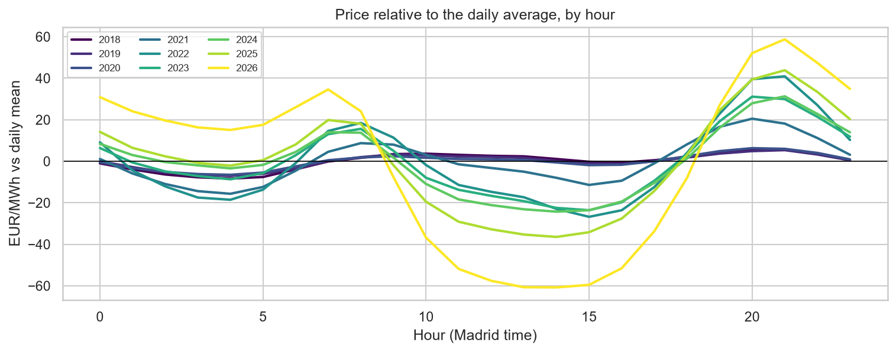

# Iberian Electricity Price Analysis (OMIE)

> How do Iberian day-ahead electricity prices behave, and can a simple model beat a naive forecast?

**Status:** 🚧 Work in progress. Data pipeline, exploration and forecasting done; final
write-up next (target: January 2027).

**Answer so far:** yes, modestly. A LightGBM model beats the naive "same hour yesterday" forecast
by 9 % (MAE 17.9 vs 19.7 EUR/MWh) over almost three years of walk-forward testing, a statistically
significant gain that comes mostly from Mondays, weekends and holidays.

## Why it matters

Electricity prices in Portugal and Spain are set daily, hour by hour, in the OMIE day-ahead market.
The fast growth of solar power is changing how these prices behave: cheaper middays, more
expensive evenings, and the first negative prices. Understanding and forecasting these patterns
matters for anyone who buys, sells, stores or trades electricity.

## Method

1. **Data:** nearly 9 years of hourly OMIE day-ahead prices for Portugal and Spain (2018–2026),
   downloaded automatically, cleaned and validated (DST days, the October 2025 switch to
   15-minute periods, gaps, outliers).
2. **Exploration:** long-term trends, volatility, daily and weekly patterns, negative prices,
   Portugal–Spain price differences, autocorrelation.
3. **Forecasting:** forecast tomorrow's 24 hourly prices for Portugal using only prices up to today
   and the calendar. Naive baselines (same hour yesterday / last week) against linear regression
   (Ridge) and gradient boosting (LightGBM), validated walk-forward from January 2024 with monthly
   retraining and no look-ahead bias (enforced by a unit test).
4. **Optional:** simulated battery arbitrage backtest.

## Results

### Forecasting

| Model (Jan 2024 – Nov 2026, 25,176 hourly forecasts) | MAE (EUR/MWh) | vs naive |
|---|---|---|
| Naive: same hour yesterday | 19.7 | — |
| Naive: same hour last week | 28.9 | 47 % worse |
| Ridge regression | 19.0 | 3 % better |
| **LightGBM** | **17.9** | **9 % better** |

- **LightGBM wins, modestly but consistently:** 9 % lower MAE, 17 % lower RMSE (fewer big misses),
  significant in a Diebold–Mariano test (p < 0.001).
- **The gain comes from the calendar:** on Mondays the error falls from 28.1 to 19.6 EUR/MWh; from
  Tuesday to Friday no model beats "same hour yesterday". Without calendar inputs LightGBM is worse
  than the naive forecast, even though those inputs rank low in feature importance.
- **Most of the remaining error is about tomorrow's price level** (a third of the error would go if
  the daily average were known), which depends on weather, demand and fuel prices not in this dataset.

Full results: **[docs/forecasting.md](docs/forecasting.md)**.

### Price behaviour



- **Solar has reshaped the day.** Until 2021 the cheapest hours were at night. Since 2022 they are
  in the early afternoon; in 2026 the 14:00 hour is about 61 EUR/MWh below the daily average and
  the 21:00 hour about 59 EUR/MWh above it.
- **Prices swing much more within the day.** The average daily range went from 30 % of the average
  price in 2018 to about 150 % in 2025–2026.
- **Negative prices appeared in April 2024** and are increasing: 613 hours in Portugal in 2026 so
  far, almost all at midday in spring.
- **Portugal and Spain split more often**: different prices in 14 % of hours in 2026, against 5 %
  in 2018, mostly at midday.
- **Prices are harder to forecast than before:** a naive "same hour yesterday" forecast is off by
  about 20 EUR/MWh on average since 2023 (5 EUR/MWh in 2018–2020).

Full findings, charts and tables: **[docs/analysis.md](docs/analysis.md)**.

## Limitations

- The dataset contains only prices. Drivers such as solar output, gas prices and interconnection
  limits are inferred from price patterns (timing, season, PT–ES splits), not measured. The 2026
  price climb in particular cannot be explained from prices alone.
- During the Iberian gas price cap (June 2022 – December 2023), part of the cost of gas generation
  was charged to consumers outside the day-ahead price.
- Day-ahead market only; intraday and balancing markets are not covered.
- Forecasting models use fixed settings (no tuning) and one validation design (monthly retraining,
  expanding window since 2018).

## Next steps

- Add day-ahead forecasts of wind, solar and demand (ENTSO-E) and gas prices (MIBGAS) as model
  inputs, to anticipate changes in tomorrow's price level.
- Try a shorter training window to adapt faster to market changes.
- Optional: battery arbitrage backtest using the growing daily price range.

## Quickstart

```bash
git clone https://github.com/samuel-prog-vaz/energy-market-analysis.git
cd energy-market-analysis
python -m venv .venv
.venv\Scripts\activate            # Windows  (macOS/Linux: source .venv/bin/activate)
pip install -r requirements.txt
pip install -e .
python -m omie.download           # fetch OMIE price files
python -m omie.clean              # build the clean dataset
python -m omie.backtest           # walk-forward forecasts and metrics (about 30 s)
```

Then open [notebooks/01_exploration.ipynb](notebooks/01_exploration.ipynb) and
[notebooks/02_forecasting.ipynb](notebooks/02_forecasting.ipynb).
Architecture, design decisions, testing and dependencies:
**[docs/technical.md](docs/technical.md)**.

## Stack

Python 3.12 · pandas · matplotlib/seaborn · statsmodels · scikit-learn · LightGBM · Jupyter ·
pytest · ruff
