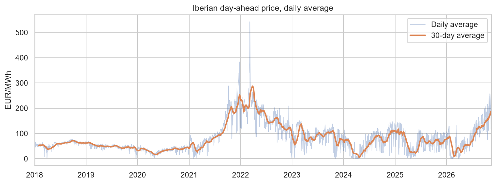
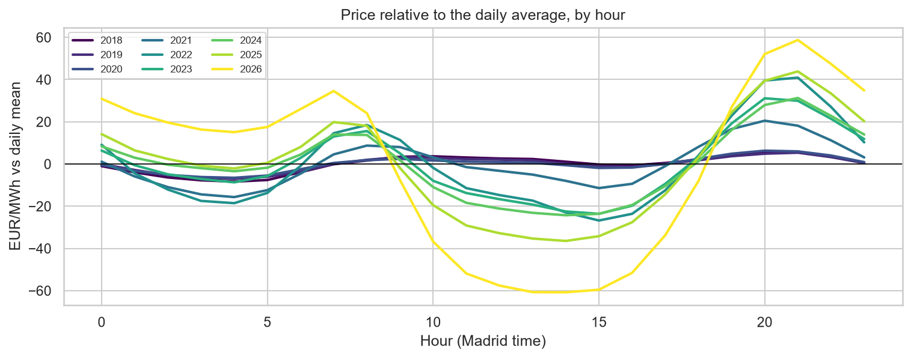
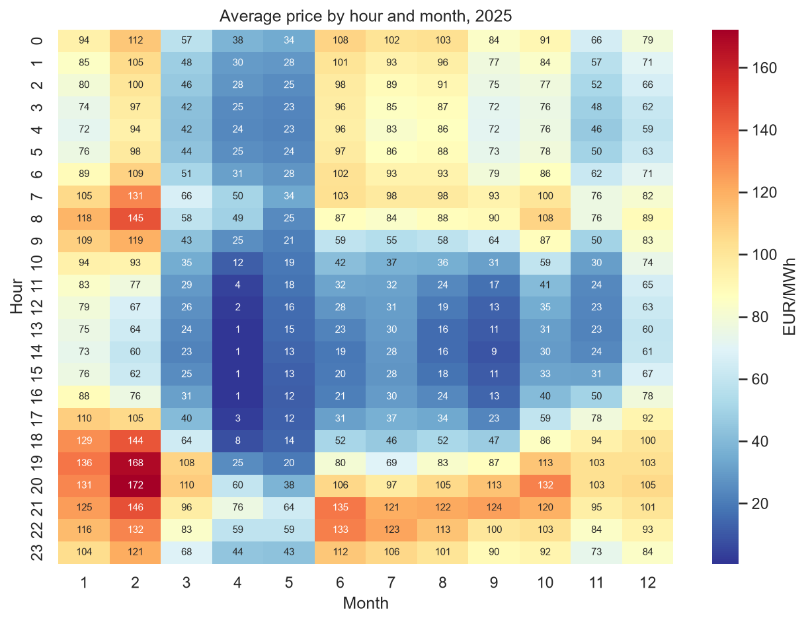
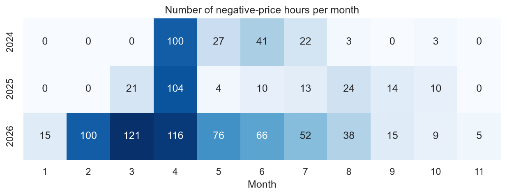
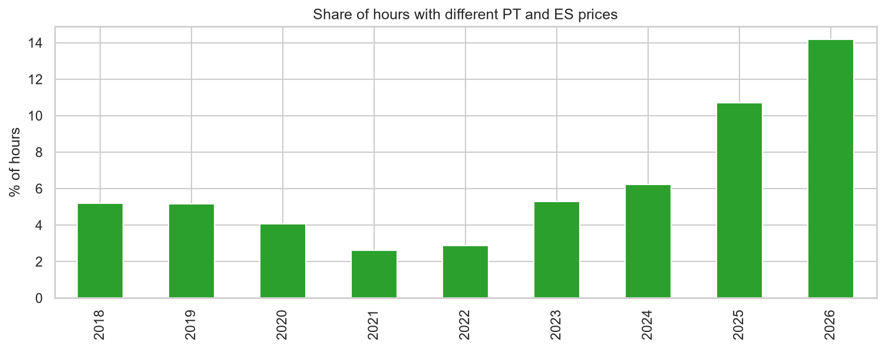

# Energy analysis: Iberian day-ahead prices

This document collects the findings of the project. The code behind every chart and number is in
[notebooks/01_exploration.ipynb](../notebooks/01_exploration.ipynb). For the forecasting results,
see [forecasting.md](forecasting.md); for how the data is built and validated, see
[technical.md](technical.md).

**Data:** OMIE day-ahead market, hourly prices in EUR/MWh, 1 Jan 2018 to 14 Nov 2026.
From 1 Oct 2025 the market clears in 15-minute periods; these are averaged to hours.
Times are Madrid local time. **All figures use the Portuguese price** unless stated otherwise;
Spain is very close (see section 6).

> **Note:** the dataset contains only these two hourly prices (Portugal and Spain). It has no
> data on solar or wind output, gas prices, demand or cross-border flows. Wherever this document
> mentions a cause (solar, gas, interconnection limits), it is an inference from price patterns
> such as timing, season and PT–ES splits, not a measurement.

**Contents**
1. [Price history](#1-price-history)
2. [Volatility: prices swing more, mostly within the day](#2-volatility-prices-swing-more-mostly-within-the-day)
3. [The daily profile and the solar "duck curve"](#3-the-daily-profile-and-the-solar-duck-curve)
4. [Weekly pattern](#4-weekly-pattern)
5. [Negative prices and spikes](#5-negative-prices-and-spikes)
6. [Portugal vs Spain](#6-portugal-vs-spain)
7. [Predictability and what it means for forecasting](#7-predictability-and-what-it-means-for-forecasting)
8. [Key takeaways](#8-key-takeaways)
9. [Limitations of this analysis](#9-limitations-of-this-analysis)

---

## 1. Price history

| Year | 2018 | 2019 | 2020 | 2021 | 2022 | 2023 | 2024 | 2025 | 2026* |
|---|---|---|---|---|---|---|---|---|---|
| Average price (EUR/MWh) | 57 | 48 | 34 | 112 | 168 | 88 | 63 | 66 | 89 |
| Highest hour (EUR/MWh) | 84 | 75 | 69 | 409 | 651 | 220 | 193 | 240 | 379 |

\* 2026 up to 14 Nov.

- **2018–2020: calm.** Prices between roughly 35 and 60 EUR/MWh, with a dip in spring 2020
  (lower demand during COVID lockdowns).
- **2021–2022: energy crisis.** Prices rose through 2021 and peaked in March 2022, when the
  three most expensive days in the dataset occurred (7–9 March 2022, up to 543 EUR/MWh daily
  average; highest single hour 651 EUR/MWh on 8 March 2022 at 18:00). This period coincides
  with the surge in European gas prices.
- **2023–2025: back to a lower level, but not to pre-crisis calm** (see section 2).
- **2026: a steady climb from spring to autumn.** Monthly averages went from 11 EUR/MWh in
  February to 197 EUR/MWh in November. The cause cannot be identified from price data alone
  (see [limitations](#9-limitations-of-this-analysis)).

## 2. Volatility: prices swing more, mostly within the day

Price variability has two parts:

- **Between days:** the price level moving over weeks and months (fuel prices, weather, seasons).
- **Within the day:** the shape of the day (solar at midday, evening peak).

| Year | 2018 | 2019 | 2020 | 2021 | 2022 | 2023 | 2024 | 2025 | 2026 |
|---|---|---|---|---|---|---|---|---|---|
| Spread between days (std of daily averages) | 10.8 | 9.3 | 9.9 | 72.5 | 62.1 | 32.6 | 38.9 | 33.8 | 59.2 |
| Spread within the day (average daily std) | 5.5 | 5.0 | 5.0 | 14.8 | 28.0 | 21.6 | 21.7 | 30.1 | 46.0 |
| Average daily range (max − min hour) | 17 | 16 | 16 | 49 | 93 | 70 | 70 | 96 | 132 |
| **Daily range ÷ average price** | **0.30** | **0.34** | **0.48** | **0.44** | **0.55** | **0.79** | **1.10** | **1.45** | **1.49** |

(all in EUR/MWh except the last row)

- **2021 was mostly a level shift:** large spread between days, small within the day. Prices
  rose over the year, but the daily shape barely changed.
- **Since 2022 the spread within the day keeps growing,** from about 5 EUR/MWh before 2021 to
  46 EUR/MWh in 2026.
- **The last row is the key one.** If prices simply got more expensive, swings would grow in
  proportion and the ratio would stay flat. Instead, the daily range went from 30 % of the
  average price in 2018 to about 150 % in 2025–2026.
- **This is not caused by the switch to 15-minute periods** (October 2025): the increase
  started in 2021, and since October 2025 the within-day variability of the 15-minute data
  (41.8 EUR/MWh) is almost the same after averaging to hours (41.6 EUR/MWh).

## 3. The daily profile and the solar "duck curve"

The chart shows each hour's price **relative to that day's average**, so years with very
different price levels can be compared by shape.

| Year | 2018 | 2020 | 2022 | 2024 | 2025 | 2026 |
|---|---|---|---|---|---|---|
| Cheapest hour of the day | 04:00 | 04:00 | 15:00 | 14:00 | 14:00 | 14:00 |
| ...relative to daily average | −8 | −7 | −27 | −24 | −36 | −61 |
| Most expensive hour | 21:00 | 20:00 | 21:00 | 21:00 | 21:00 | 21:00 |
| ...relative to daily average | +6 | +6 | +41 | +31 | +44 | +59 |

- **Until 2021 the cheapest hours were at night (around 04:00)**, when demand is lowest, and the
  day was fairly flat.
- **From 2022 the cheapest hours moved to the early afternoon (14:00–15:00).** This matches the
  growth of solar generation: on sunny days solar covers much of the demand at midday and pushes
  prices down.
- **The evening peak (20:00–21:00) grew at the same time.** When the sun sets, demand is still
  high and more expensive plants (typically gas) set the price.
- The result is the "duck curve" shape: low belly at midday, steep ramp in the evening. In 2026
  the gap between the 14:00 and 21:00 hours is about 120 EUR/MWh on an average day.

The heatmap shows the same effect across the year (2025). The cheapest cell is 15:00 in April
(about 1 EUR/MWh on average), the most expensive is 20:00 in February (about 172 EUR/MWh):
spring middays are cheap, winter evenings are expensive.

## 4. Weekly pattern

Using 2023 onwards (to keep the crisis out of the averages):

| | Weekdays | Weekends |
|---|---|---|
| Average price (EUR/MWh) | 81.9 | 62.1 |

Weekend prices are about **24 % lower**, because industrial and commercial demand drops. Unlike
the daily cycle, this pattern has no physical cause: it comes purely from the human calendar.

## 5. Negative prices and spikes

- **Negative prices did not exist in this market before April 2024.** The first one in Portugal
  was on 5 April 2024. A negative price means producers pay to keep generating, which happens
  when solar and wind output is high and demand is low.
- **They are becoming more frequent:** 196 hours in 2024, 200 in 2025, and 613 in 2026 so far.
  Counting zero prices as well, 10 % of all hours in 2026 had a price of zero or below.
- **They happen in spring, at midday:** April has the most (320 hours over the three years),
  and almost all occur between 10:00 and 17:00, peaking at 15:00.
- **Spikes are concentrated in the 2021–2022 crisis**, especially winter evenings
  (see section 1).

## 6. Portugal vs Spain

Portugal and Spain form a single market and normally have the same price. The prices only
split when the interconnection between the two countries is full ("market splitting").

| Year | 2018 | 2019 | 2020 | 2021 | 2022 | 2023 | 2024 | 2025 | 2026 |
|---|---|---|---|---|---|---|---|---|---|
| Hours with different prices | 5.2 % | 5.2 % | 4.1 % | 2.6 % | 2.9 % | 5.3 % | 6.2 % | 10.7 % | 14.2 % |

- **Splits have become much more frequent since 2024**, almost three times the 2018 share in 2026.
- **They happen mostly at midday:** since 2024, prices differ in about 22–23 % of the hours
  between 11:00 and 15:00, against 2–4 % at night.
- **When they differ, Portugal is usually more expensive** (79 % of split hours since 2024,
  typically by about 5 EUR/MWh). This is consistent with cheap Spanish solar at midday that the
  interconnection cannot fully export to Portugal, but confirming it would require flow data.
- As a result, Portugal had fewer negative-price hours than Spain (1,009 vs 1,564 since 2024).

## 7. Predictability and what it means for forecasting

Autocorrelation measures how similar the price is to itself a given number of hours earlier
(2024 onwards):

| Lag | 1 h | 6 h | 12 h | 24 h | 48 h | 168 h (1 week) |
|---|---|---|---|---|---|---|
| Correlation | 0.96 | 0.53 | 0.45 | 0.87 | 0.79 | 0.76 |

- **Strong daily cycle (24 h):** driven by the Earth's rotation, both directly (solar output) and
  through human daily routines.
- **Weekly cycle (168 h):** driven by the human calendar (lower weekend demand).
- **Very high 1-hour correlation:** prices are persistent, because weather and fuel prices change
  slowly. This cannot be used for a day-ahead forecast, since the previous hour is not yet known
  when tomorrow's forecast is made.

**Naive forecast errors** (mean absolute error, EUR/MWh) are the benchmark the forecasting models
must beat (results in [forecasting.md](forecasting.md)):

| Naive forecast | 2018 | 2019 | 2020 | 2021 | 2022 | 2023 | 2024 | 2025 | 2026 |
|---|---|---|---|---|---|---|---|---|---|
| Same hour yesterday | 5.2 | 5.1 | 5.3 | 15.9 | 27.2 | 19.6 | 18.1 | 19.9 | 21.2 |
| Same hour last week | 6.4 | 6.7 | 6.7 | 24.9 | 39.6 | 28.7 | 27.0 | 29.3 | 30.3 |

**Implications for the models:**
- Useful inputs: hour of day, recent prices (lags of 24 h and 168 h), weekday/weekend.
- The market changes regime (2021–2022 crisis, 2026 climb), so models must be validated
  walk-forward, i.e. always trained on the past and tested on the following period.
- Errors should be compared per year and against the naive forecast, because 20 EUR/MWh of error
  means something very different in 2020 than in 2022.

## 8. Key takeaways

Based on the takeaways written in the notebook (section 9), refined with the numbers above:

- The share of hours with different prices in Portugal and Spain has increased.
- Prices vary more in recent years, mainly **within the day**, and this is not an effect of the
  switch to 15-minute periods (section 2).
- Prices are strongly correlated with the same hour of the previous day, following the daily
  cycle of the Earth's rotation and human routine.
- 2021, 2022 and 2026 show a wider spread of prices. This is real market behaviour, not noise:
  in 2021 mainly a level shift over the year, in 2022 and 2026 both level shifts and bigger
  daily swings.

## 9. Limitations of this analysis

- **Prices only.** The dataset contains only prices. Drivers such as solar output, gas prices and
  interconnection limits are inferred from price patterns (timing, season, PT–ES splits), not
  measured. Confirming them would need generation and cross-border flow data (ENTSO-E) or gas
  prices (MIBGAS). In particular, the 2026 climb cannot be explained from prices alone.
- **Iberian gas price cap (June 2022 – December 2023).** During the "Iberian exception", part of
  the cost of gas generation was paid to producers outside the day-ahead price and charged to
  consumers separately. Day-ahead prices in this period are therefore lower than the full cost
  consumers paid.
- **Day-ahead market only.** Intraday and balancing markets, where prices can differ, are not
  included.
- **Hourly averages after October 2025.** Averaging quarter-hours hides some detail inside each
  hour, although the effect on overall variability is small (section 2).
