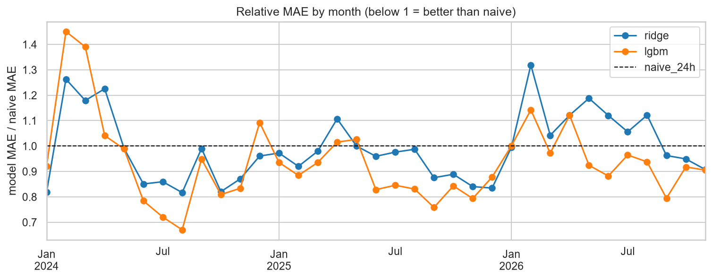
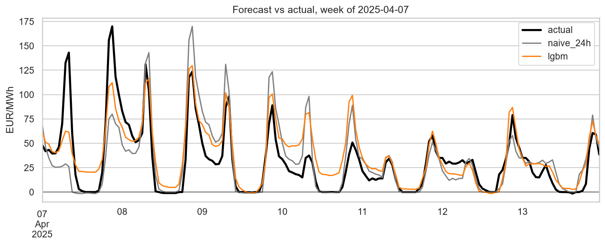
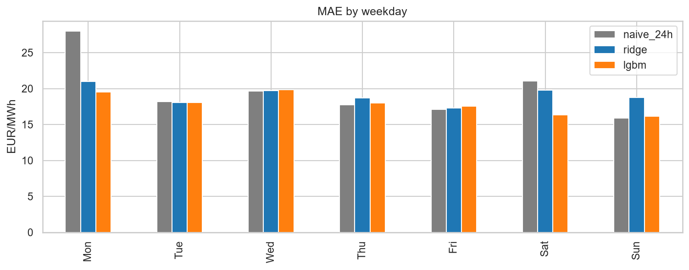
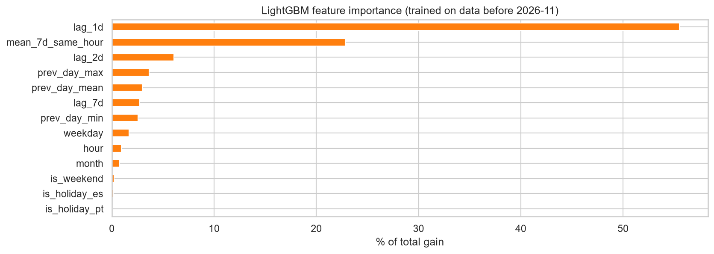

# Forecasting: can a simple model beat a naive forecast?

This document reports the forecasting part of the project. The code is in
[src/omie/features.py](../src/omie/features.py) and [src/omie/backtest.py](../src/omie/backtest.py);
every chart and table below is reproduced in
[notebooks/02_forecasting.ipynb](../notebooks/02_forecasting.ipynb). For what the prices look like,
see [analysis.md](analysis.md); for implementation details, see [technical.md](technical.md).

**Short answer: yes, modestly.** LightGBM beats the naive "same hour yesterday" forecast by 9 %
(MAE 17.9 vs 19.7 EUR/MWh) over almost three years of walk-forward testing, and the difference is
statistically significant. The gain comes mostly from Mondays, weekends and holidays. Most of the
remaining error is about tomorrow's overall price level, which depends on information this dataset
does not contain (weather, demand, fuel prices).

**Contents**
1. [Setup](#1-setup)
2. [Models and inputs](#2-models-and-inputs)
3. [Results](#3-results)
4. [Where the models win and lose](#4-where-the-models-win-and-lose)
5. [What drives the models](#5-what-drives-the-models)
6. [Is the improvement significant?](#6-is-the-improvement-significant)
7. [Key takeaways](#7-key-takeaways)
8. [Limitations and next steps](#8-limitations-and-next-steps)

---

## 1. Setup

- **Task:** on day D−1, before the market closes at noon, forecast the 24 hourly prices of day D.
- **Information allowed:** prices up to the end of day D−1 (published on D−2) and the calendar.
  Nothing from day D. A unit test checks this by corrupting all prices from day D onwards and
  confirming that day D's inputs do not change.
- **Price:** Portugal (`price_pt`), EUR/MWh. Quarter-hour prices after October 2025 are averaged to
  hours.
- **Test period:** 1 Jan 2024 to 14 Nov 2026, 1,049 days and 25,176 hourly forecasts.
- **Walk-forward validation:** every month, the models are retrained on all data before that month
  (starting in January 2018) and then forecast every day of the month. Training data always ends
  before the test month starts.
- **Metrics:**
  - **MAE** (mean absolute error), in EUR/MWh;
  - **RMSE** (root mean squared error), which penalises big misses more;
  - **relative MAE**: model MAE ÷ naive 24 h MAE. Below 1 means the model beats the naive forecast.

## 2. Models and inputs

| Model | Description |
|---|---|
| `naive_24h` | Same hour, previous day. **The benchmark.** |
| `naive_168h` | Same hour, same weekday last week |
| `ridge` | Linear regression with a small penalty (Ridge); numeric inputs scaled, calendar inputs one-hot encoded |
| `lgbm` | Gradient boosting (LightGBM): 500 small decision trees, each correcting the previous ones |

**Inputs** (13 in total; prices and calendar only):

| Group | Inputs |
|---|---|
| Recent prices, same hour | price 1, 2 and 7 days earlier; 7-day average |
| Previous day | average, minimum and maximum of day D−1 |
| Calendar | hour, weekday, month, weekend flag, Portuguese and Spanish public holidays |

## 3. Results

| Model | MAE | RMSE | Relative MAE |
|---|---|---|---|
| Naive 24 h | 19.66 | 30.04 | 1.000 |
| Naive 168 h | 28.89 | 40.88 | 1.470 |
| Ridge | 19.04 | 25.96 | 0.969 |
| **LightGBM** | **17.92** | **25.03** | **0.912** |

(EUR/MWh; full tables in [reports/forecast_metrics.md](../reports/forecast_metrics.md))

- **LightGBM is the best model:** 9 % lower MAE and 17 % lower RMSE than the naive forecast.
  The larger RMSE gain means it mainly avoids big misses.
- **Ridge improves on the naive forecast only slightly** (3 % lower MAE).
- **"Same hour last week" is much worse** than "same hour yesterday": recent information matters
  more than matching the weekday.

**By year (relative MAE):**

| Year | Ridge | LightGBM |
|---|---|---|
| 2024 | 0.930 | 0.925 |
| 2025 | 0.940 | 0.876 |
| 2026 | 1.037 | 0.937 |

The models do not win every month. LightGBM was worse than the naive forecast in February–April
2024 and best in August 2024 (relative MAE 0.67). Ridge was worse than naive for most of the first
half of 2026, which is why it loses to the naive forecast over that year. A possible explanation,
not tested here, is that both models train on all data since 2018, including the 2021–2022 crisis,
and adapt slowly when the market changes.

*Example: week of 7 April 2025, a spring week with very low and negative midday prices.*

## 4. Where the models win and lose

### By day of the week

| Day type | Days | Naive 24 h | LightGBM |
|---|---|---|---|
| Monday | 145 | 28.1 | 19.6 |
| Portuguese holiday | 36 | 21.8 | 18.5 |
| Saturday | 146 | 20.9 | 16.3 |
| Sunday | 142 | 15.8 | 16.0 |
| Tuesday–Friday | 580 | 18.1 | 18.3 |

**The models win where the calendar matters.** The naive forecast copies Sunday's low prices into
Monday and Friday's higher prices into Saturday; the models know the weekday. **From Tuesday to
Friday, no model beats "same hour yesterday"**: when consecutive days are similar, yesterday's price
is already a very good forecast.

### By hour of day

| Hours | Naive 24 h | Ridge | LightGBM |
|---|---|---|---|
| 00–06 | 17.0 | 16.1 | 15.0 |
| 07–09 | 23.7 | 19.3 | 18.2 |
| 10–16 | 20.2 | 21.4 | 19.2 |
| 17–19 | 21.0 | 20.9 | 20.0 |
| 20–23 | 19.2 | 18.6 | 19.0 |

The morning ramp (07–09) gains the most. Midday (10–16), when solar output varies from day to day,
is hard: Ridge is worse than the naive forecast there.

### By price level

| Actual price (EUR/MWh) | Hours | Naive 24 h | Ridge | LightGBM |
|---|---|---|---|---|
| ≤ 0 | 1,926 | 5.4 | 16.1 | 10.2 |
| 0–25 | 5,108 | 16.7 | 23.9 | 20.8 |
| 25–50 | 3,067 | 23.4 | 19.7 | 19.5 |
| 50–100 | 7,248 | 22.9 | 16.1 | 17.0 |
| 100–150 | 5,452 | 19.0 | 16.5 | 16.0 |
| 150–200 | 1,603 | 21.9 | 21.9 | 21.7 |
| > 200 | 772 | 30.0 | 31.1 | 26.8 |

**Zero and negative prices are forecast worse by the models than by the naive forecast.** A likely
explanation (not tested here) is that such hours often come in runs of similar sunny, windy days, so
"same as yesterday" works well, while the models pull forecasts towards more typical price levels.

### The biggest misses

Most of LightGBM's 10 worst days are days when the price changed sharply from the day before
(e.g. 12 November 2026: the daily average fell by about 95 EUR/MWh). Nothing in the inputs signals
such a change in advance.

### Level vs shape

Each day's error can be split into a **level** part (getting the day's average price wrong) and a
**shape** part (getting the hourly profile wrong once the level is right):

| Model | MAE | Average error in the day's level | MAE if the daily level were known |
|---|---|---|---|
| Naive 24 h | 19.7 | 15.7 | 14.6 |
| Ridge | 19.0 | 13.7 | 13.3 |
| LightGBM | 17.9 | 14.2 | 11.7 |

If LightGBM knew each day's average price in advance, its error would fall by about a third. **Most
of the remaining error is about tomorrow's level**, which depends on weather, demand and fuel prices
that are not in this dataset.

## 5. What drives the models

LightGBM's feature importance (share of total gain, trained on data up to October 2026):
price one day earlier 55.5 %, 7-day average 22.8 %, price two days earlier 6.1 %, other previous-day
statistics 2.5–3.6 % each, and all calendar inputs together about 3.6 %.

**Low importance does not mean useless.** Retraining LightGBM *without* any calendar inputs gives:

| Day type | Naive 24 h | LightGBM | LightGBM without calendar |
|---|---|---|---|
| Monday | 28.1 | 19.6 | 22.5 |
| Portuguese holiday | 21.8 | 18.5 | 21.8 |
| Saturday | 20.9 | 16.3 | 20.4 |
| Sunday | 15.8 | 16.0 | 19.0 |
| Tuesday–Friday | 18.1 | 18.3 | 20.0 |
| **All days** | **19.7** | **17.9** | **20.3** |

Without the calendar, LightGBM is **worse** than the naive forecast. The importance chart understates
the calendar for three reasons:

1. **Overlap:** yesterday's price for the same hour already carries the hour-of-day pattern, so the
   model gets most of the hour effect from the price inputs.
2. **Crisis-dominated training data:** gain measures how much each input reduced the squared error
   during training (2018–2026). The 2021–2022 crisis produced errors of hundreds of EUR/MWh that only
   price-level inputs can reduce; a weekday effect of 10–20 EUR/MWh looks small next to that.
3. **Effects on few days:** holidays are about 13 days a year, and the Monday and Saturday
   corrections apply to 2 days out of 7. Summed over all training rows the gain is small, but on
   those days the effect is large.

The general lesson: feature importance shows what a model used most during training, not what it
cannot do without. Removing an input and re-testing is the more reliable check.

## 6. Is the improvement significant?

A lower MAE could be luck. The **Diebold–Mariano test** checks whether one model's errors are
consistently lower than another's. Following common practice in electricity price forecasting,
the 24 hourly differences in absolute error are averaged into one value per day, and a one-sided
test is applied to the 1,049 daily values.

| Comparison | DM statistic | p-value | Significant at 5 %? |
|---|---|---|---|
| LightGBM better than naive 24 h | 5.04 | < 0.001 | Yes |
| Ridge better than naive 24 h | 2.44 | 0.007 | Yes |
| LightGBM better than Ridge | 5.35 | < 0.001 | Yes |

**Both models are significantly better than the naive forecast**, and LightGBM is significantly
better than Ridge. The improvement is modest in size but consistent.

## 7. Key takeaways

From the notebook (section 9):

- The LightGBM model gives a modest improvement over the naive 24 h forecast (about 9 % lower MAE).
  Most of the remaining error comes from tomorrow's price *level*, which depends on weather, demand
  and fuel prices that aren't in this dataset.
- The LightGBM model performs slightly better than the Ridge model.
- Calendar features show low importance in the LightGBM feature-importance chart but are essential:
  without them LightGBM is worse than the naive forecast.

## 8. Limitations and next steps

**Limitations**
- **Prices and calendar only.** No weather, demand or fuel price information, which limits how well
  any model can anticipate changes in tomorrow's price level.
- **One test design.** Monthly retraining on an expanding window since 2018; other choices (shorter
  training windows, weekly retraining) were not tested.
- **No hyperparameter tuning.** Ridge and LightGBM use reasonable default settings. Tuning would need
  a separate validation period to avoid overfitting the test period.
- **Significance test assumptions.** The DM test assumes the daily loss differences are roughly
  independent; their day-to-day correlation is small (about 0.1), so the conclusions are unlikely to
  change, but a correction for it was not applied.
- **DST days** are fitted into 24 hours (2 days a year), and post-October 2025 hours are averages of
  four quarter-hours.

**Next steps**
- Add **day-ahead forecasts** of wind, solar and demand (ENTSO-E publishes them before the auction,
  so they are legitimate inputs; actual values would be look-ahead) and gas prices (MIBGAS).
- Try a shorter training window (e.g. the last 1–2 years) to adapt faster to market changes.
- Optional: use the forecasts in a simple battery arbitrage backtest.
