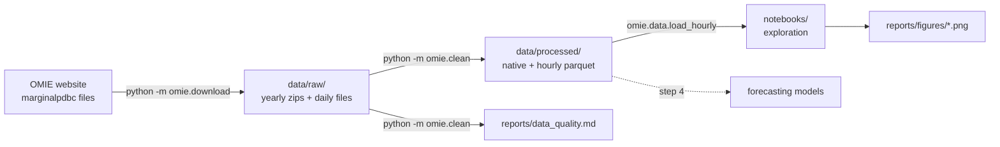

# Technical documentation

How the project is built: data pipeline, code structure, design decisions, testing and
dependencies. For the findings, see [analysis.md](analysis.md).

**Contents**
1. [Architecture](#1-architecture)
2. [Project structure](#2-project-structure)
3. [Data source](#3-data-source)
4. [Pipeline steps](#4-pipeline-steps)
5. [Design decisions](#5-design-decisions)
6. [Validation and testing](#6-validation-and-testing)
7. [Dependencies](#7-dependencies)
8. [Reproducing the results](#8-reproducing-the-results)

---

## 1. Architecture



The pipeline has two commands and runs top to bottom. Raw data and processed data are not
committed to git: anyone can rebuild them from the public OMIE files with the two commands.

## 2. Project structure

```
data/
  raw/marginalpdbc/      downloaded OMIE files (not committed)
  processed/             cleaned parquet datasets (not committed)
docs/                    hand-written documentation (this file, analysis.md)
notebooks/               analysis notebooks
reports/                 files generated by code: data quality report, figures
src/omie/                reusable Python package
  config.py              project paths (no hard-coded C:\... paths anywhere)
  download.py            fetch raw files from OMIE
  clean.py               parse, timestamp, aggregate, validate, write outputs
  data.py                load the processed data for analysis (load_hourly)
tests/                   unit tests (pytest)
pyproject.toml           package definition and tool settings (pytest, ruff)
requirements.txt         dependencies
```

`src/omie` is installed in editable mode (`pip install -e .`), so notebooks and scripts can
`import omie` from any folder, and code changes take effect without reinstalling.

## 3. Data source

- **Market:** OMIE (Operador del Mercado Ibérico de Energía), day-ahead market, Portugal and Spain.
- **Files:** `marginalpdbc_YYYYMMDD.N`, one per delivery day, published at
  `https://www.omie.es/es/file-download?parents=marginalpdbc&filename=<file>`.
  For completed years OMIE also publishes `marginalpdbc_YYYY.zip` with all daily files
  (available for 2018–2022 at the time of writing).
- **Format:**

  ```
  MARGINALPDBC;
  2024;03;31;1;3.2;3.2;        year;month;day;period;price_PT;price_ES;
  ...
  *
  ```

- **Periods:** numbered from 1 at local midnight in Spanish time (Europe/Madrid), which is how the
  market defines its day. Portuguese clocks are one hour behind, but the market day is the same.

| Period | Normal day | Spring DST day | Autumn DST day |
|---|---|---|---|
| Until 30 Sep 2025 (hourly) | 24 | 23 | 25 |
| From 1 Oct 2025 (15-minute) | 96 | 92 | 100 |

## 4. Pipeline steps

### `python -m omie.download` ([download.py](../src/omie/download.py))

1. For each year from 2018: try the yearly zip; if it does not exist, download daily files
   up to tomorrow (day-ahead prices for tomorrow are published around midday).
2. Skip files already on disk, so re-running only fetches new days.
3. For each day, try file versions `.1` to `.5` and keep the first one found.
4. Wait 0.2 s between requests and retry failed connections, to be polite to OMIE's server.

### `python -m omie.clean` ([clean.py](../src/omie/clean.py))

1. **Parse** every raw file (inside zips and loose), skipping header and footer lines. If a day
   has several versions, keep the latest.
2. **Timestamp** each period (see [5.1](#51-utc-timestamps-for-dst)).
3. **Aggregate** quarter-hours to hours by averaging (see [5.2](#52-the-15-minute-switch)).
4. **Validate** the result (see [section 6](#6-validation-and-testing)).
5. **Write**
   - `data/processed/omie_prices_native.parquet`: every period as published
     (`datetime_utc`, `datetime_local`, `date`, `period`, `resolution_min`, `price_pt`, `price_es`)
   - `data/processed/omie_prices_hourly.parquet`: continuous hourly series
     (`datetime_utc`, `datetime_local`, `price_pt`, `price_es`)
   - [reports/data_quality.md](../reports/data_quality.md): check results and yearly summary

### Loading for analysis ([data.py](../src/omie/data.py))

`load_hourly()` reads the hourly parquet, indexes it by Madrid local time and adds calendar
columns (`date`, `year`, `month`, `hour`, `weekday`, `weekday_name`, `is_weekend`).

## 5. Design decisions

### 5.1 UTC timestamps for DST

Each period's start time is computed as *local midnight converted to UTC + (period − 1) ×
period length*. In UTC there is no daylight saving time, so the series is evenly spaced, with no
duplicated or missing hours on the 23- and 25-hour days. Local time (`datetime_local`) is kept
next to it, because daily patterns follow the clock. The period length is derived from the data:
hours in that day ÷ number of periods, which gives 60 or 15 minutes.

### 5.2 The 15-minute switch

Since 1 Oct 2025 the European day-ahead market clears in 15-minute periods. Two datasets are kept:

- **native:** every period as published, nothing lost;
- **hourly:** quarter-hours averaged to hours, giving one continuous series from 2018 for
  analysis and modelling.

Averaging loses little: since October 2025, within-day variability is almost identical before and
after averaging (see [analysis.md, section 2](analysis.md#2-volatility-prices-swing-more-mostly-within-the-day)).

### 5.3 File versions

Most days are published as version `.1`, but some exist only as `.2` or `.3`
(e.g. 28 May 2023, 30 Oct 2025, 27 Nov 2025). The downloader tries versions in order; the cleaner
keeps the highest version if several are on disk.

### 5.4 Rebuild instead of append

`omie.clean` rebuilds the processed files from all raw files on every run instead of appending new
days. At about 107,000 rows this takes seconds, and it guarantees that:

- processed data always matches the raw files exactly (corrections and code fixes are picked up);
- validation always runs on the full series;
- results are reproducible from a clean clone.

### 5.5 HTTPS certificate verification

OMIE's server does not send its full certificate chain. Python's default certificate bundle
(`certifi`) cannot complete it, so requests fail verification. Instead of disabling verification,
the project uses `truststore`, which verifies against the operating system's certificate store.

## 6. Validation and testing

### Data checks (run by `omie.clean`, results in `reports/data_quality.md`)

| Check | Why |
|---|---|
| Every day has a valid number of periods (60- or 15-minute) | Detects truncated or malformed files |
| No duplicated timestamps | Detects overlapping files or timestamp bugs |
| No missing hours between first and last timestamp | Detects missing days |
| No missing prices | Detects parse errors |
| Prices within [−500, 5000] EUR/MWh | Detects impossible values (wider than any market limit used so far) |

### Unit tests (`pytest`, [tests/](../tests))

Tests use small synthetic files and cover:

- parsing (header/footer, negative and decimal prices);
- timestamps on normal days, both DST days, 15-minute days and a 15-minute DST day;
- the resolution column and averaging quarter-hours to hours;
- a continuous hourly series across the 1 Oct 2025 switch;
- validation catching a missing hour and an out-of-range price.

Run them with `pytest`. Code style is checked with `ruff check src tests` and
`ruff format --check src tests`.

## 7. Dependencies

Python 3.11 or later (developed on 3.12). All packages are listed in
[requirements.txt](../requirements.txt).

| Package | Used for |
|---|---|
| pandas, numpy | Data handling |
| requests | Downloading files from OMIE |
| truststore | HTTPS verification with the operating system's certificate store (see 5.5) |
| pyarrow | Reading and writing parquet files |
| tabulate | Markdown tables in the data quality report |
| matplotlib, seaborn | Charts |
| statsmodels | Autocorrelation and statistical models |
| scikit-learn, lightgbm | Forecasting models (step 4) |
| jupyterlab, ipykernel | Notebooks |
| pytest | Unit tests |
| ruff | Linting and formatting |

## 8. Reproducing the results

```bash
git clone <repo-url>
cd energy-market-analysis
python -m venv .venv
.venv\Scripts\activate            # Windows  (macOS/Linux: source .venv/bin/activate)
pip install -r requirements.txt
pip install -e .
pytest                            # unit tests
python -m omie.download           # fetch raw data (re-run to update)
python -m omie.clean              # build processed data + data quality report
jupyter nbconvert --to notebook --execute --inplace notebooks/01_exploration.ipynb
```

The first download takes a few minutes (about 1,400 daily files for the years without a yearly
archive). Later runs only fetch new days.
